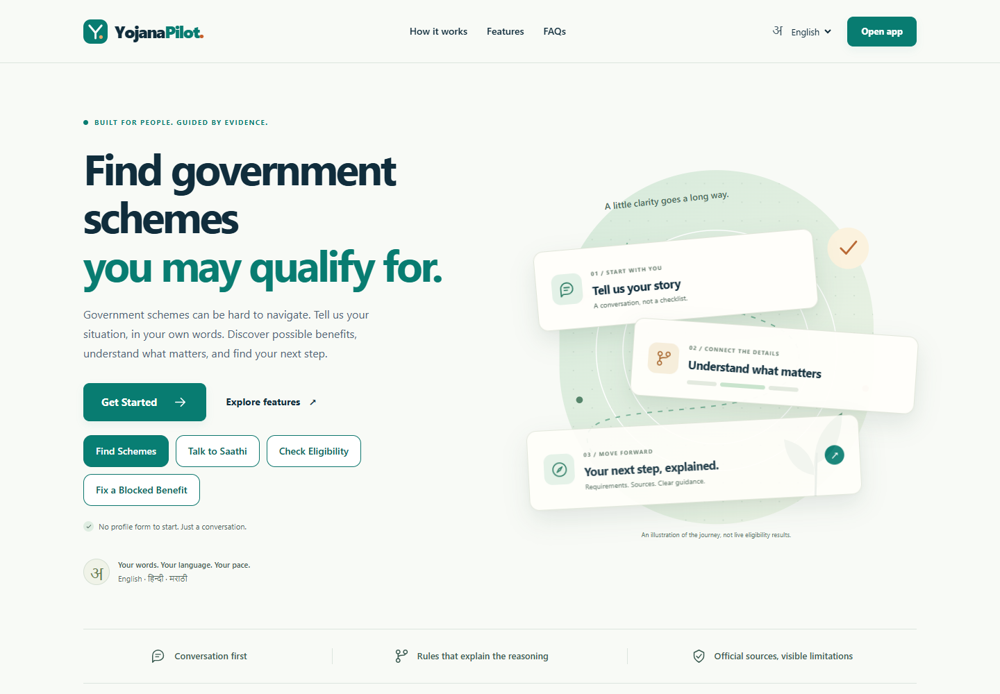
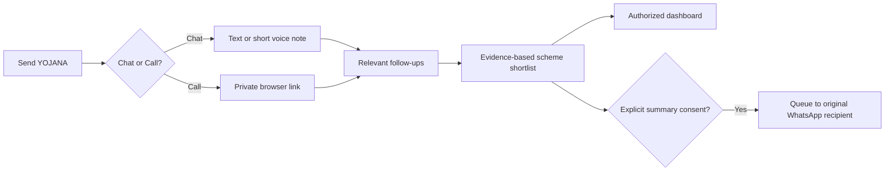
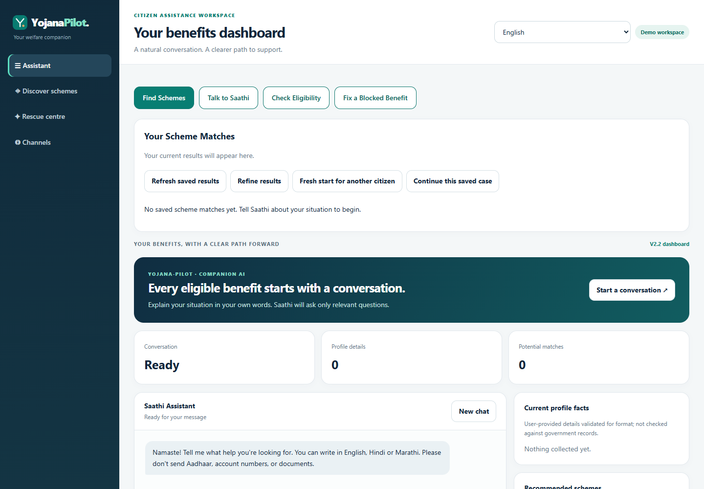
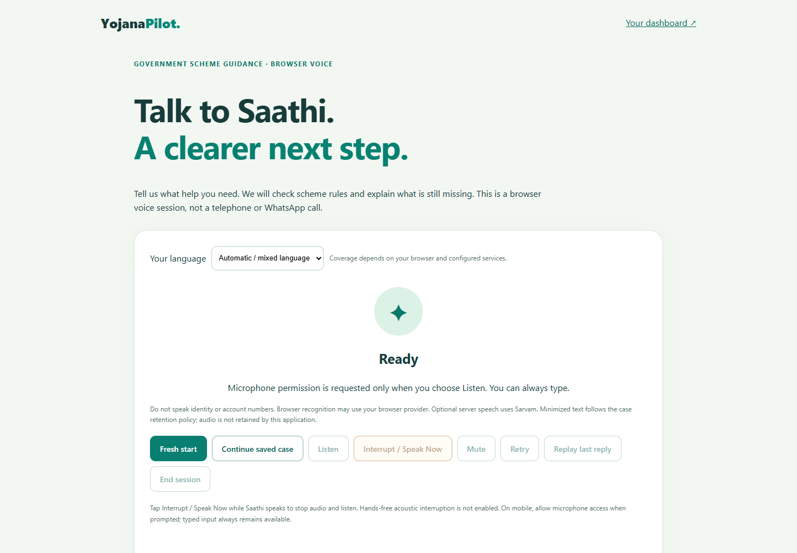
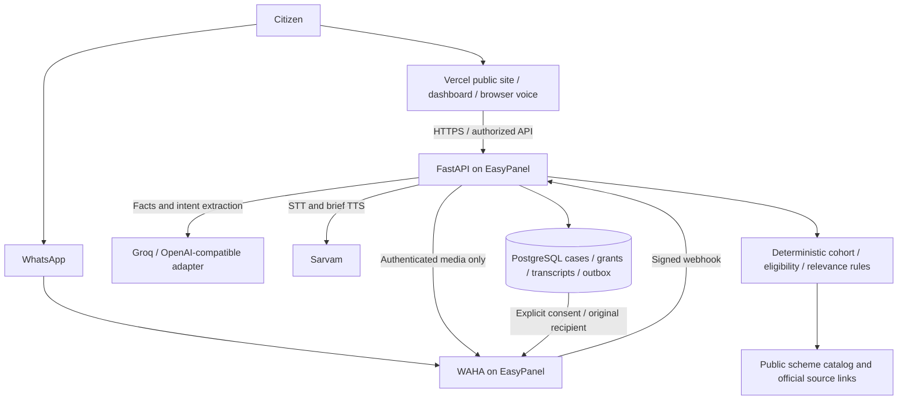



<div align="center">

# Yojana Saathi

### A conversation that helps citizens find their next step.

**Discover welfare schemes, understand eligibility and investigate application blockers in your own words.**

[GitHub](https://github.com/ShrE333/Yojana-Pilot) · [Demo runbook](docs/WHATSAPP_FINAL.md) · [Deployment](DEPLOYMENT.md) · [Security](SECURITY.md)

FastAPI · PostgreSQL · Groq · Sarvam · WAHA · Vercel · EasyPanel

</div>

> **Submission status:** reviewable `feature/v2.5-citizen-experience` candidate. Public deployment URLs and a demo video have not been supplied or independently verified in this checkout. Local tests do not establish live WhatsApp, speech-provider availability or recipient delivery.



## Meet Saathi

Citizens explain their situation instead of filling out a long profile form. Saathi extracts facts, asks relevant follow-ups and presents source-linked recommendations. **The language model reads and explains. Deterministic code decides eligibility.** Missing facts remain unknown; unreviewed scraped rules never become proof of entitlement. This is independent guidance, not a government service or approval system.

## One citizen case, multiple ways to continue

| Experience | What it does |
| --- | --- |
| **YOJANA activation** | Exact command: `YOJANA`, `yojna` or `योजना`, normalizing case, Unicode, whitespace and surrounding punctuation. Silent before opt-in. |
| **WhatsApp Chat** | Reply `Chat` / `चैट` / `चॅट`, then send ordinary text or short voice notes. No numbered menu. |
| **Voice notes** | Authenticated WAHA media → bounded OGG/Opus decoding → server-side Sarvam STT → the same eligibility conversation → text reply. Up to 15 seconds and 2 MB input. |
| **Browser Call** | Reply `Call` / `कॉल` for a private one-use HTTPS link expiring in 10 minutes. Continues the same authorized case; not a native WhatsApp call. |
| **Tap-to-interrupt** | Stops audio, browser synthesis and pending TTS; invalidates stale playback and resumes microphone capture after the tap. Typed fallback remains available. No acoustic hands-free claim. |
| **Multilingual** | English, Hindi and Marathi have synthetic fixture coverage and localized follow-ups. Explicit language changes preserve the case. The 23-language registry is not a claim of live coverage. |
| **Automatic assessment** | Relevant follow-ups, evidence-based completion and separate cohort safeguards for college students, schoolchildren and seniors. |
| **Dashboard** | Authorized profile, transcript, recommendations and browser-call history can be restored. Fresh citizens do not inherit another person's facts. |
| **Rescue Mode** | Investigates user-reported portal text, document mismatches and dependencies. No invented government status. |
| **Consent** | Summaries require explicit consent and the original recipient. STOP clears the channel case and revokes outstanding access. |



## The actual interface

Captures of the running local application with an empty synthetic workspace. No phone numbers, QR codes, credentials or private handoff links.

| Citizen workspace | Browser voice |
| --- | --- |
|  |  |

**WhatsApp screenshot / demo video:** not available yet. Add a redacted capture from a controlled live account after [external acceptance](docs/WHATSAPP_FINAL.md#external-acceptance). A simulated WhatsApp image would not establish a working integration.

## Architecture



Raw audio is processed in bounded backend memory and is not stored in the case database. WAHA's transient file cache is separate: configure ephemeral storage and short retention. Provider processing and service logs have separate policies; obtain consent before sharing messages with configured services.

## Verification and demo links

| Surface | Local evidence | Public/live evidence |
| --- | --- | --- |
| `/`, `/app`, `/chat` redirect, `/legacy`, `/docs` | HTTP and browser PASS | Public origins not supplied; UNVERIFIED |
| `/api/health/live`, `/api/health/ready` (`/healthz`, `/readyz` aliases) | HTTP PASS | Backend origin not supplied; UNVERIFIED |
| YOJANA, Chat/Call, text, voice-note flow, STOP, retries | Signed synthetic webhook PASS | Actual paired WAHA engine UNVERIFIED |
| OGG/Opus conversion | Real local ffmpeg decoder PASS | Container runtime UNVERIFIED |
| Groq and Sarvam STT/TTS | Contract tests / mocked responses PASS | Account-backed calls UNVERIFIED |
| Voice interruption, saved results, mobile layout | Browser PASS; audio/mic simulated | Physical iOS/Android audio UNVERIFIED |
| Persistence | SQLite adapter PASS | Real PostgreSQL skipped without `TEST_POSTGRES_URL` |
| WhatsApp recipient delivery | Correct-recipient outbox PASS | UNVERIFIED; API acceptance is not delivery |

Use the real frontend origin plus `/app` and `/voice` for demo links, and the real backend origin plus `/api/health/live` and `/api/health/ready` for health checks. No guessed deployment domains are published here.

## Run locally

Use standard Python 3.13, Node 22 for the standalone build, and ffmpeg on PATH for WhatsApp audio. The backend Dockerfile installs ffmpeg.

```powershell
git clone --branch feature/v2.5-citizen-experience https://github.com/ShrE333/Yojana-Pilot.git
Set-Location Yojana-Pilot
py -3.13 -m venv .venv
.\.venv\Scripts\python.exe -m pip install -r requirements-deploy.txt -r requirements-dev.txt
Copy-Item deploy/.env.example .env
# Configure and load runtime variables privately in your shell/service.
# Never put provider keys in frontend/public or commit .env.
.\.venv\Scripts\python.exe -m web --port 8000 --no-browser
```

Open `http://localhost:8000/`, `/app` or `/voice`. Copying the production template alone does not configure PostgreSQL or hosted inference. For a deliberately mocked offline demonstration use the [fixture setup](docs/AGENTX_DEMO.md). Do not present fixtures as live inference.

```powershell
.\.venv\Scripts\python.exe -m pytest -q
.\.venv\Scripts\python.exe scripts/sync_frontend.py --check
# Use your actual backend HTTPS origin for a deployable build:
$env:BACKEND_ORIGIN = 'https://YOUR-ACTUAL-BACKEND-ORIGIN'
node frontend/build.mjs
.\.venv\Scripts\python.exe scripts/deployment_smoke.py --url 'https://YOUR-ACTUAL-FRONTEND-ORIGIN'
```

**Latest tests: 360 passed, 0 failed, 1 skipped.** See the [final integration report](docs/WHATSAPP_FINAL.md). Real PostgreSQL validation requires a disposable database in `TEST_POSTGRES_URL`.

## Deploy and protect citizen data

See [deployment](DEPLOYMENT.md), [environment template](deploy/.env.example), [WAHA Compose](deploy/waha.compose.yaml) and [voice-note runbook](docs/WHATSAPP_FINAL.md). Keep existing PostgreSQL data and the session-signing key stable. Run all four additive migrations before traffic. Build frontend and backend from the same reviewed commit.

- HMAC-authenticated webhooks; direct citizen messages only. No bot echoes, group or broadcast activation.
- Trusted WAHA-origin media with authenticated headers, no redirects or arbitrary URL downloads. Bounded bytes, time, decoder threads, duration and concurrency.
- One-use invitations, expiring grants, authorized case reads and no cross-user summaries.
- Durable deduplication and reply outbox. STOP blocks in-flight media from restoring a revoked case.
- No Aadhaar, bank or identity numbers requested; sensitive input rejected/redacted. No raw audio or secrets logged by the adapter.
- Explicit summary consent and revocation. WAHA acceptance stays distinct from recipient delivery.
- Scheme names, official links and deterministic requirements stay unchanged across language selection.

## Project map

`core/` policy · `saathi/` conversation · `schemes/` fields/rules · `web/` FastAPI, channels and assets · `web/migrations/` storage · `frontend/` Vercel build · `deploy/` templates · `tests/` regression coverage · `docs/` runbooks and architecture.

Built for AgentX. Questions: [repository issues](https://github.com/ShrE333/Yojana-Pilot/issues). No government affiliation, beneficiary totals or partner endorsements are claimed.
